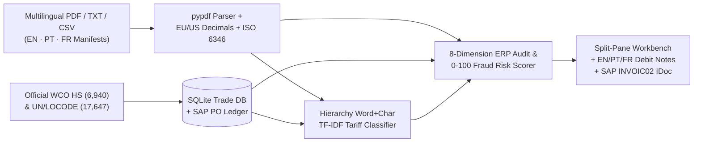

# DocuRecon AI — Customs Manifest, WCO NLP Tariff & ERP Audit Workbench

[](https://python.org)
[](https://fastapi.tiangolo.com)
[](#official-public-trade-data-provenance)
[](#official-public-trade-data-provenance)
[](#quick-start)
[](LICENSE)

A precision customs compliance, trade fraud scoring, and multilingual shipping document reconciliation workbench built with **Python, FastAPI, Scikit-Learn, pypdf, and SQLite**. Parses genuine **PDF, TXT, CSV, and JSON** shipping documents in **English, Portuguese, and French**, classifies commodities against **6,940 official WCO HS Tariff Codes**, validates ports against **17,647 official UN/LOCODE Seaports**, verifies **ISO 6346 container check digits**, audits **FOB/CIF cargo valuation**, and cross-matches every dimension against a live **SAP Purchase Order ledger**.

---

## System Architecture



---

## Core Production Capabilities

| Module | What It Does |
| :--- | :--- |
| **1. Split-Pane Document Workbench** | Drag-and-drop single or multi-file batch `.pdf`, `.txt`, `.csv`, `.json` manifests. Live `pypdf` extraction with inline pass/warn/fail highlights synchronized with the 8-dimension ERP audit table. |
| **2. Hierarchy WCO HS NLP Classifier (`6,940` Codes)** | Dual **Word (1,2) + Char-WB (3,5) TF-IDF** ensemble joining 6-digit WCO subheadings with their 4-digit headings and 2-digit chapters, plus multilingual **EN / PT / FR** trade synonym normalization. |
| **3. 8-Dimension ERP & Fraud Audit (`0–100` Score)** | Audits Shipper Entity (token-set matching), WCO HS Tariff, UN/LOCODE Maritime Corridor, Gross Weight (1% tolerance + KG→MT), Ocean Freight Surcharges, **FOB/CIF Cargo Valuation (1.5% over/under-invoicing check)**, Cold-Chain Reefer Temperature, and **ISO 6346 Container Check Digit**. |
| **4. Automated Multilingual Carrier Debit Notes** | Drafts formal carrier dispute & credit-note notices in **English, Portuguese, or French** with 1-click Copy, `.txt` Download, and `mailto:` launch. |
| **5. Deduplicated Audit Ledger & SAP PO CRUD** | Full Create/Edit/Delete SAP Purchase Order management, deduplicated unique-shipment financial metrics (zero double-counting on re-audits), CSV ledger export, and `INVOIC02_CUSTOMS_RECON` SAP JSON payloads. |

---

## Included Multilingual Sample Documents (`sample_docs/`)

* `BOL_BRSSZ_AOLAD_8841.pdf` *(EN · Santos → Luanda)* — Catches **+0.80 MT** weight variance & **+$750** freight surcharge (`HOLD_FOR_AMENDMENT`).
* `FATURA_COMERCIAL_BRPNG_AOLAD_9104.pdf` *(PT · Paranagua → Luanda)* — 100% verified beef shipment (`APPROVE_GREEN_CHANNEL`).
* `FATURA_DISCREPANCIA_BRSSZ_AOLAD_9318.pdf` *(PT · Santos → Luanda)* — Parses European decimals (`5.120,00`, `38.900,00`), catches **+$620** freight surcharge + **+$3,400** FOB over-invoicing, and auto-drafts a **Portuguese Nota de Débito**.
* `BORDEREAU_CNSGH_AOLAD_7729.pdf` *(FR · Shanghai → Luanda)* — Catches **-15.4°C** cold-chain thermal breach (`QUARANTINE_VET_INSPECTION`).
* `INV_INNSA_AEJEA_4410.pdf` *(EN · Nhava Sheva → Jebel Ali)* — Auto-converts `25,000 KG → 25.00 MT` and catches **HS Tariff mismatch (`1006.40` vs `1006.30`)** + **+$380** freight overcharge.
* `INV_RUNVS_AEJEA_6042.pdf` *(EN · Novorossiysk → Jebel Ali)* — Bulk **Granular Urea 46% N Fertilizer** (`HS 3102.10`), 100% verified (`APPROVE_GREEN_CHANNEL`).
* `MANIFEST_NLRTM_NGLOS_5520.txt` *(EN · Rotterdam → Lagos)* — 100% compliant dairy manifest (`APPROVE_GREEN_CHANNEL`).

---

## Quick Start

```bash
# 1. Install dependencies
pip install -r requirements.txt

# 2. Download official WCO HS Codes & UN/LOCODE Seaports into SQLite
python scripts/download_reference_data.py

# 3. Generate real multilingual sample PDFs (with valid ISO 6346 container IDs)
python scripts/generate_sample_docs.py

# 4. Run the application
python app.py
# Workbench: http://127.0.0.1:8001 | Swagger Docs: http://127.0.0.1:8001/docs

# 5. Run automated tests (10/10 passing)
python -m unittest discover -s tests -v
```

## Deploy to Render.com

Includes `render.yaml` with automatic health checks (`/api/health`), `$PORT` binding, and automatic WCO NLP index verification on startup.
